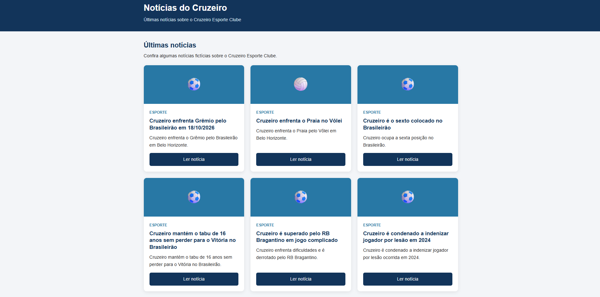

# Nome

César Ribeiro Dias Monção

## Matrícula

933330

## Prints

Home-page

Página de detalhes do item

## Dados JSON do app.js

const noticias = [
    {
        id: 1,
        titulo: "Cruzeiro enfrenta Grêmio pelo Brasileirão em 18/10/2026",
        descricao: "Cruzeiro enfrenta o Grêmio pelo Brasileirão em Belo Horizonte.",
        conteudo: "Cruzeiro enfrenta o Grêmio pelo Brasileirão em Belo Horizonte no dia 18/10/2026. O jogo promete ser emocionante, com torcedores de ambos os times comparecendo ao estádio para apoiar suas equipes.\n\nA partida é aguardada com grande expectativa pelos fãs de futebol da cidade e da região.",
        categoria: "Esporte",
        autor: "Sérgio Lima",
        data: "2026-10-12",
        icone: "⚽",
        cor: "cor-azul"
    },
    {
        id: 2,
        titulo: "Cruzeiro enfrenta o Praia no Vôlei",
        descricao: "Cruzeiro enfrenta o Praia pelo Vôlei em Belo Horizonte.",
        conteudo: "Cruzeiro enfrenta o Praia pelo Vôlei em Belo Horizonte no dia 20/10/2026. O jogo promete ser emocionante, com torcedores de ambos os times comparecendo ao ginásio para apoiar suas equipes.\n\nA partida é aguardada com grande expectativa pelos fãs de vôlei da cidade e da região.",
        categoria: "Esporte",
        autor: "Lucas Almeida",
        data: "2026-10-10",
        icone: "🏐",
        cor: "cor-azul"
    },
    {
        id: 3,
        titulo: "Cruzeiro é o sexto colocado no Brasileirão",
        descricao: "Cruzeiro ocupa a sexta posição no Brasileirão.",
        conteudo: "Após várias rodadas do Brasileirão, o Cruzeiro se encontra na sexta colocação da tabela. A equipe tem mostrado um desempenho consistente, com vitórias importantes e alguns empates ao longo da competição.\n\nOs torcedores esperam que o time continue a evoluir e busque posições ainda melhores nas próximas partidas.",
        categoria: "Esporte",
        autor: "Pedro Santos",
        data: "2026-10-08",
        icone: "⚽",
        cor: "cor-azul"
    },
    {
        id: 4,
        titulo: "Cruzeiro mantém o tabu de 16 anos sem perder para o Vitória no Brasileirão",
        descricao: "Cruzeiro mantém o tabu de 16 anos sem perder para o Vitória no Brasileirão.",
        conteudo: "No último confronto pelo Brasileirão, o Cruzeiro conseguiu manter o tabu de 16 anos sem perder para o Vitória. A partida foi marcada por muita emoção e gols decisivos, consolidando a superioridade histórica do time mineiro sobre o adversário.\n\nOs torcedores celebraram a vitória e reforçaram a confiança na equipe para os próximos desafios da competição.",
        categoria: "Esporte",
        autor: "Ana Ribeiro",
        data: "2026-10-05",
        icone: "⚽",
        cor: "cor-azul"
    },
    {
        id: 5,
        titulo: "Cruzeiro é superado pelo RB Bragantino em jogo complicado",
        descricao: "Cruzeiro enfrenta dificuldades e é derrotado pelo RB Bragantino.",
        conteudo: "Em um jogo complicado pelo Brasileirão, o Cruzeiro foi superado pelo RB Bragantino. A equipe mineira encontrou dificuldades para impor seu ritmo e acabou cedendo gols importantes ao adversário.\n\nOs torcedores esperam que o time consiga se recuperar nas próximas partidas e retome o caminho das vitórias.",
        categoria: "Esporte",
        autor: "Rafael Lima",
        data: "2026-10-02",
        icone: "⚽",
        cor: "cor-azul"
    },
    {
        id: 6,
        titulo: "Cruzeiro é condenado a indenizar jogador por lesão em 2024",
        descricao: "Cruzeiro é condenado a indenizar jogador por lesão ocorrida em 2024.",
        conteudo: "O Cruzeiro foi condenado a indenizar um jogador que sofreu uma lesão durante uma partida em 2024. A decisão judicial considerou que o clube não tomou as medidas adequadas para garantir a segurança do atleta.\n\nA indenização visa reparar os danos sofridos pelo jogador e reforçar a importância da responsabilidade dos clubes em relação à integridade física de seus atletas.",
        categoria: "Esporte",
        autor: "Juliana Martins",
        data: "2026-09-28",
        icone: "⚽",
        cor: "cor-azul"
    }
];